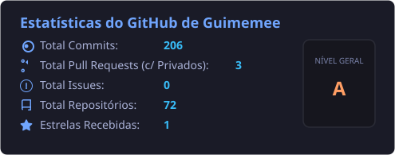
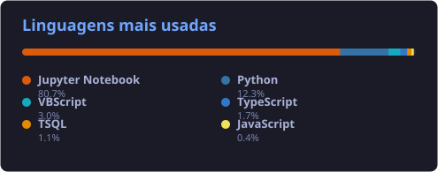

<!-- ========================================================
     CYBER PROFILE README - GITHUB HOMEPAGE (Guimemee/Guimemee)
     Tema: Dark Sci-Fi / Cyberpunk Terminal (Espelhado no GitPage)
======================================================== -->

<div align="center">

  <!-- BANNER ANIMADO DE APRESENTAÇÃO -->
  <a href="https://guimemee.github.io">
    
  </a>

  <p align="center">
    <strong>Engenheiro de Computação em formação pela FIAP • Especialista em Pipelines de Dados, BI Corporativo & Hardware Crítico</strong>
  </p>

  <!-- STATUS PILLS / BADGES -->
  <p align="center">
    <a href="https://guimemee.github.io"></a>
    <a href="https://www.linkedin.com/in/guimemee/"></a>
    
    
  </p>

</div>

---

### ⚡ // MÉTRICAS TÉCNICAS & ATIVIDADE CONSOLIDADA

<table align="center" width="100%">
  <tr>
    <td align="center" width="25%" bgcolor="#0e121b">
      <br>
      <br>
      <h2 align="center"><code>155+</code></h2>
      <p align="center"><small><strong>Modelos Corporativos Internos</strong><br>DAX Avançado, SLAs & Custos</small></p>
    </td>
    <td align="center" width="25%" bgcolor="#0e121b">
      <br>
      <br>
      <h2 align="center"><code>45</code></h2>
      <p align="center"><small><strong>Pipelines & Modelagem</strong><br>DDL, Views Analíticas & ETL</small></p>
    </td>
    <td align="center" width="25%" bgcolor="#0e121b">
      <br>
      <br>
      <h2 align="center"><code>4</code></h2>
      <p align="center"><small><strong>Desafios Corporativos</strong><br>HAOC, Natura, Sanofi & SPI</small></p>
    </td>
    <td align="center" width="25%" bgcolor="#0e121b">
      <br>
      <br>
      <h2 align="center"><code>242</code></h2>
      <p align="center"><small><strong>Atividades Avaliativas</strong><br>Provas Públicas + Exercícios Privados</small></p>
    </td>
  </tr>
</table>

---

> [!IMPORTANT]
> ### 🔒 GOVERNANÇA ACADÊMICA: POLÍTICA DE EXERCÍCIOS VS. PROVAS
> * **Exercícios de Fixação & Laboratórios de Bancada:** Mantidos sob sigilo institucional restrito (**🔒 Privados**), contudo permanecem **integralmente auditados e computados na contagem volumétrica total de 242 avaliações acadêmicas** da graduação.
> * **Provas Oficiais, Checkpoints & NACs:** **100% públicos e auditáveis**, com resoluções algébricas passo a passo (padrão Symbolab), cadernos interativos Jupyter (`SymPy`, `NumPy`, `Matplotlib`) e relatórios técnicos.
> * **Corporate Challenges & Global Solutions:** Totalmente públicos, documentados com portais dedicados via GitHub Pages.

---

### 🏛️ // PROJETOS ACADÊMICOS — FIAP CHALLENGES (4 DESAFIOS OFICIAIS)

Os **Challenges Corporativos da FIAP** representam desafios de inovação aberta realizados em parceria anual direta com grandes multinacionais e hospitais de referência:

| Ano | Empresa Parceira & Desafio | Resumo da Solução de Engenharia | Acesso ao Projeto |
| :---: | :--- | :--- | :---: |
| **2022** | **Hospital Alemão Oswaldo Cruz (HAOC)** | Robótica hospitalar autônoma de leitos, telemetria clínica em tempo real, modelagem CAD 3D no Autodesk Inventor e análise de break-even de viabilidade econômica. | [🌐 Portal Live](https://guimemee.github.io/fiap-challenge-2022-haoc/)<br>[📂 Repositório](https://github.com/Guimemee/fiap-challenge-2022-haoc) |
| **2023** | **Natura Innovation Challenge** | Monitoramento ambiental amazônico com rede de telemetria LoRaWAN de longo alcance, rastreabilidade de bioeconomia, backend Java Clean Code e IA para biomassa. | [🌐 Portal Live](https://guimemee.github.io/fiap-challenge-2023-natura/)<br>[📂 Repositório](https://github.com/Guimemee/fiap-challenge-2023-natura) |
| **2024** | **Sanofi EC Pharma Challenge** | Embarcação não tripulada (USV) autônoma para coleta de microplásticos aquáticos, propulsão elétrica solar, detecção por visão computacional YOLOv8 e navegação GPS-RTK. | [🌐 Portal Live](https://guimemee.github.io/fiap-challenge-2024-sanofi/)<br>[📂 Repositório](https://github.com/Guimemee/fiap-challenge-2024-sanofi) |
| **2025** | **SPI / Metaindústria Smart Robotics** | Gêmeos Digitais 3D na nuvem, células robóticas de manufatura flexível 4.0, barramento determinístico industrial OPC UA e governança de cibersegurança fabril sob norma IEC 62443. | [🌐 Portal Live](https://guimemee.github.io/fiap-challenge-2025-spi-metaindustria/)<br>[📂 Repositório](https://github.com/Guimemee/fiap-challenge-2025-spi-metaindustria) |

<details>
<summary><strong>📄 Visualizar Artigos e Cadernos Técnicos Internos dos Challenges</strong></summary>
<br>

* **Hospital Alemão Oswaldo Cruz (2022):**
  * [NeuroSky & Circuitos Digitais: Delimitação Lógica da Solução](./oswaldo-cruz-docs/digital_circuits_neurosky.md)
  * [Estudo de Física: Balança de Precisão e Células de Carga (HX711)](./oswaldo-cruz-docs/physics_scale_hx711.md)
  * [Internet das Coisas (IoT): Protocolo MQTT na Indústria 4.0](./oswaldo-cruz-docs/iot_mqtt_industry.md)
  * [Design Mecânico: Concepção do Robô Auxiliar e Modelagem 3D (CAD)](./oswaldo-cruz-docs/robotics_oswaldo_cruz.md)
* **Cadernos Científicos & Sprints:**
  * [Sprint 1: Resolução completa de Matemática, Circuitos Digitais e Ergonomia](./fiap-challenges/2022_sprint1_resolucao.md)
  * [Sprint 3: Resolução de Física (Mecânica e Torque), Cálculo e Controle de Motores](./fiap-challenges/2022_sprint3_resolucao.md)
  * [Visão Computacional: Detecção de Padrões com YOLOv8](./fiap-challenges/Imagens_Checkpoint_4_PARTE_01_Modelos_de_Vis%C3%A3o_Computacional_com_Yolo_V8_.ipynb)
</details>

---

### 🌐 // GLOBAL SOLUTIONS FIAP (9 PROJETOS INTERDISCIPLINARES)

Projetos semestrais interdisciplinares de alta densidade técnica abrangendo todas as cadeiras de engenharia da FIAP (2 por ano de 2022 a 2025 e 1 no último ano letivo de 2026):

| Período | Tema & Desafio Global | Solução de Engenharia & Tecnologias | Repositório |
| :---: | :--- | :--- | :---: |
| `2022 • 1º Sem` | **⚡ Electrical Mobility** | Dimensionamento de powertrain e instrumentação física de grandezas de veículos elétricos modulares (velocidade, torque, baterias). | [🔗 Acessar](https://github.com/Guimemee/fiap-electrical-engineering-lab-skills) |
| `2022 • 2º Sem` | **🚗 Smart Mobility (Carsharing IoT)** | Sistema de sensoriamento IoT automotivo, rastreamento GPS/GSM, circuitos lógicos de bancada e modelagem CAD veicular. | [🔗 Acessar](https://github.com/Guimemee/fiap-digital-circuits-and-logic) |
| `2023 • 1º Sem` | **🌱 Tech for Good (Agricultura)** | Analisador automático de solo com PCB dedicada KiCad, telemetria contínua Java (pH, condutividade e umidade) e fotobiologia microcontrolada. | [🔗 Acessar](https://github.com/Guimemee/fiap-advanced-programming-and-mobile-dev) |
| `2023 • 2º Sem` | **👕 TechCare 4 All (E-Textile)** | Camiseta inteligente (*smartshirt*) para monitoramento de sinais vitais (ECG, temperatura corporal e pressão arterial) com Bluetooth. | [🔗 Acessar](https://github.com/Guimemee/fiap-embedded-systems) |
| `2024 • 1º Sem` | **🌊 Blue Future (Microplásticos)** | Embarcação autônoma USV para contenção marinha com RTOS determinístico, IA de visão computacional e simulação Cisco Packet Tracer. | [🔗 Acessar](https://github.com/Guimemee/fiap-sistemas-operacionais) |
| `2024 • 2º Sem` | **🔋 Green Energy (Smart Charging)** | Infraestrutura para eletromobilidade, balanceamento inteligente de rede elétrica, telemetria em nuvem e dashboards analíticos de recarga. | [🔗 Acessar](https://github.com/Guimemee/fiap-computer-engineering-portfolio) |
| `2025 • 1º Sem` | **🌍 ESA Digital Twin Earth** | Gêmeos digitais planetários orientados a microsserviços distribuídos em nuvem e processamento de fluxos geoespaciais em tempo real. | [🔗 Acessar](https://github.com/Guimemee/fiap-computacao-distribuida-e-cloud-computing) |
| `2025 • 2º Sem` | **🤖 Indústria 5.0 (Cobots & OT)** | Robótica colaborativa (Cobots), modelagem de autômatos celulares, linguagens formais e governança de segurança cibernética fabril (IEC 62443). | [🔗 Acessar](https://github.com/Guimemee/fiap-computer-engineering-portfolio) |
| `2026 • 1º Sem` | **🛰️ Deep Space Network (Aeroespacial)** | Infraestrutura de missão crítica e tolerância a falhas para operações em espaço profundo com FreeRTOS e automação autônoma de nós de telemetria. | [🔗 Acessar](https://github.com/Guimemee/fiap-sistemas-de-tempo-real) |

---

### 💼 // ECOSSISTEMA CORPORATIVO & AUTOMAÇÕES INDUSTRIAIS

<details open>
<summary><strong>📊 Visualizar Acervo de Automações Corporativas Homologadas</strong></summary>
<br>

* **📊 Microsoft Power BI & DAX Avançado:** 155+ relatórios e dashboards corporativos confidenciais desenvolvidos para monitoramento operacional, controle de SLAs de expedição, conciliação fiscal e engenharia de custos operacionais.
* **📱 Microsoft Power Apps:** Aplicações Canvas integradas a Dataverse e SharePoint para auditoria de inventário fabril, aprovação de despesas e triagem de ordens de serviço.
* **🤖 SAP GUI & Bots Python/VBScript:** Mais de 110 rotinas de automação robótica de processos (RPA) para lançamentos em massa no módulo SAP EWM/MM, emissão automatizada de ordens e reconciliação fiscal.
* **🗄️ SQL & Data Warehouse:** 45 scripts de DDL, views analíticas, stored procedures e rotinas de ingestão no Oracle Cloud, BigQuery e PostgreSQL.

> *Todo o framework de automações corporativas públicas está documentado em [portfolio-codigos-geral](https://github.com/Guimemee/portfolio-codigos-geral).*
</details>

---

### 📊 // ATIVIDADE GIT & TELEMETRIA GITHUB

<div align="center">
  
  &nbsp;
  
</div>

---

### 🛠️ // STACK TECNOLÓGICO & COMPETÊNCIAS

<div align="center">

| Categoria | Tecnologias & Ferramentas Homologadas |
| :--- | :--- |
| **Linguagens & Scripts** |         |
| **Dados & Cloud** |       |
| **Corporativo & RPA** |      |
| **Hardware & IoT** |      |

</div>

---

### 💻 // TERMINAL CLI SIMULADO (CYBER BASH)

```bash
guilherme@fiap:~$ ./query_acervo.sh --summary
========================================================================
⚡ GUILHERME MACÁRIO DA SILVA — SUMMARY DA GRADUAÇÃO & CARREIRA
========================================================================
[ACADÊMICO] FIAP • Engenharia de Computação (2022 - 2026)
[CHALLENGES] 4 Parcerias Concluídas: HAOC, Natura, Sanofi, SPI Metaindústria
[GLOBAL SOL] 9 Projetos Semestrais Homologados (2/ano até 2025 | 1 em 2026)
[AVALIAÇÕES] 242 Entregas Totais (🔒 Exercícios Privados + 🔓 Provas Públicas)
[DATA & BI]  155+ Power BIs Corporativos Privados | 45 Scripts SQL DW
[AUTOMAÇÕES] 110+ Scripts SAP GUI & Python RPA de Alta Performance
[STATUS]     100% dos Repositórios Oficiais Conectados e Auditados
========================================================================
guilherme@fiap:~$ █
```

---

### 📬 // CONECTE-SE COMIGO

<div align="center">

  <a href="https://guimemee.github.io" target="_blank">
    
  </a>
  &nbsp;
  <a href="https://www.linkedin.com/in/guimemee/" target="_blank">
    
  </a>
  &nbsp;
  <a href="https://github.com/Guimemee" target="_blank">
    
  </a>
  &nbsp;
  <a href="mailto:guilherme.macario@aluno.fiap.com.br">
    
  </a>

  <br><br>
  <sub><i>"Transformando dados em inteligência e engenharia em soluções autônomas escaláveis."</i></sub>

</div>
